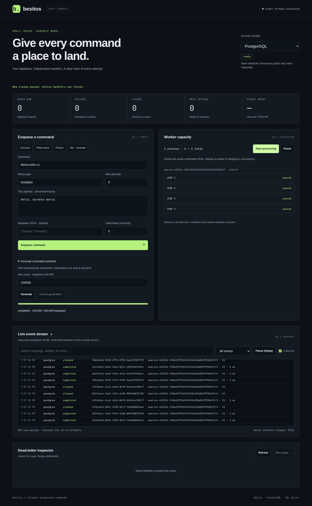

# Besitos

**Small queue. Durable work. Your database.**

Besitos adds reliable background commands to your existing database.
Use SQLite, PostgreSQL, or SQL Server through the same API.

- **Keep work safe.** Persist commands before execution. Recover expired leases after a crash.
- **Handle failure.** Use bounded retries, dead letters, and explicit replay.
- **Enqueue together.** Submit bounded batches with one atomic commit.
- **Control capacity.** Run independent worker loops. Add processes when you need more consumers.
- **See what happens.** Inspect live events, active leases, and failures in the browser console.
- **Start deliberately.** Aspire starts the console. You choose which databases and workers to activate.
- **Keep your stack.** Use the library with an ordinary .NET host, without Aspire or the demo.

```csharp
builder.Services.AddSqliteQueue("Data Source=work.db");
builder.Services.AddQueueHandler<SendReceipt>("receipt.send.v1");
builder.Services.AddQueueWorker();

await queue.EnqueueAsync(new Envelope(
    Command: "receipt.send.v1",
    Payload: "{\"orderId\":42}",
    PayloadMediaType: "application/json"));
```

Commands keep their original text, media type, and metadata.
Delivery is **at least once**. Handlers must tolerate duplicate execution.

[Start the demo](.github/docs/quickstart.md) · [Use the library](.github/docs/library.md) · [Read the test results](.github/docs/verification.md)



Built for .NET 10. Designed for backlogs up to 100,000 items.
[Measured results](.github/docs/verification.md) describe the tested environment and limits.
